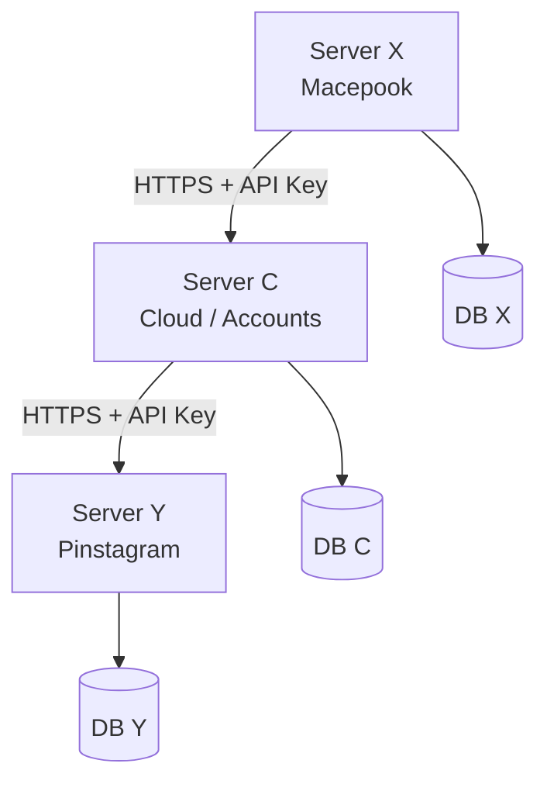
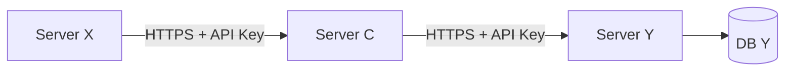
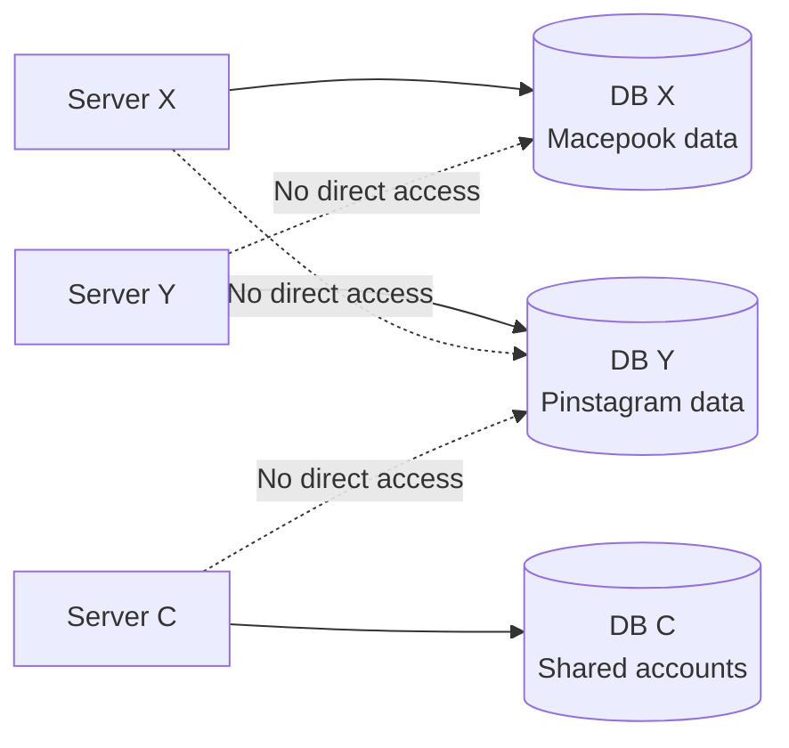
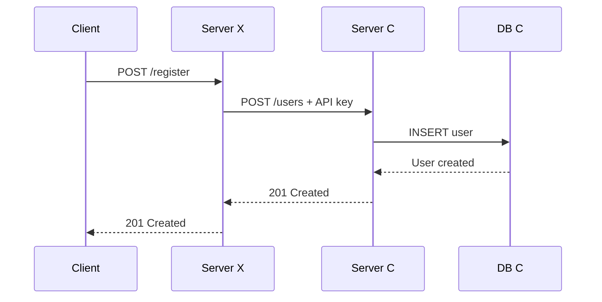
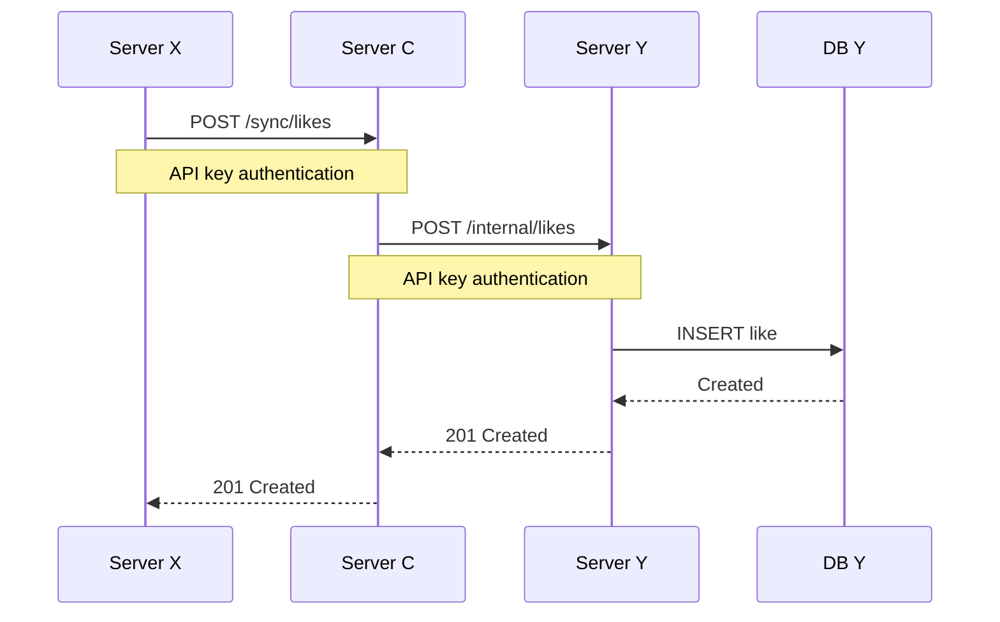

# Backend / Cloud Solution with Python

A small distributed backend system built with **Python, Flask, PostgreSQL, Neon and Vercel**.

The project demonstrates how three independent services can communicate securely while keeping ownership of their own databases.

> **The main rule:**  
> Nobody gets direct access to somebody else's database.  
> If Server X needs something from Server Y, it has to go through the front door. No sneaking through the database window. 

---

## 1. Project Overview

The system consists of three independent Flask services:

- **Server X** — Macepook
- **Server Y** — Pinstagram
- **Server C** — Cloud / shared account service

Each social media service has its own PostgreSQL database.

Server C stores shared user account information and acts as an intermediary for cross-service communication.

### Architecture



The important synchronization path is:



Server X never connects directly to DB Y.

Server C also does not connect directly to DB Y. It asks Server Y to perform the operation.

This keeps database ownership clear and services independent.

---

# 2. Services

## Server X — Macepook

**Responsibility:** handles likes, comments and reactions for Macepook.

**Database:** DB X

**Production URL:**

`https://server-x-five.vercel.app`

### Endpoints

| Method | Endpoint | Purpose |
|---|---|---|
| GET | `/` | Health/status check |
| POST | `/likes` | Create a like |
| GET | `/likes/<user_id>` | Get user's likes |
| POST | `/comments` | Create a comment |
| GET | `/comments/<user_id>` | Get user's comments |
| POST | `/reactions` | Create a reaction |
| GET | `/reactions/<user_id>` | Get user's reactions |
| POST | `/register` | Register a shared user through Server C |
| POST | `/login` | Login through Server C |
| POST | `/sync/likes` | Request synchronization with Server Y through Server C |

---

## Server Y — Pinstagram

**Responsibility:** handles likes, comments and reactions for Pinstagram.

**Database:** DB Y

**Production URL:**

`https://server-y.vercel.app`

### Endpoints

| Method | Endpoint | Purpose |
|---|---|---|
| GET | `/` | Health/status check |
| POST | `/register` | Register a shared user through Server C |
| POST | `/login` | Login through Server C |
| POST | `/likes` | Create a like |
| GET | `/likes/<user_id>` | Get user's likes |
| POST | `/comments` | Create a comment |
| GET | `/comments/<user_id>` | Get user's comments |
| POST | `/reactions` | Create a reaction |
| GET | `/reactions/<user_id>` | Get user's reactions |
| POST | `/internal/likes` | Internal endpoint used by Server C |

The `/internal/likes` endpoint is protected by an API key and is intended for service-to-service communication.

---

## Server C — Cloud

**Responsibility:** manages shared user accounts and coordinates communication between services.

**Database:** DB C

**Production URL:**

`https://server-c-iota.vercel.app`

### Endpoints

| Method | Endpoint | Purpose |
|---|---|---|
| GET | `/` | Health/status check |
| POST | `/users` | Create a shared user |
| GET | `/users/<user_id>` | Retrieve a user |
| POST | `/login` | Authenticate a user |
| POST | `/sync/likes` | Forward a like operation to Server Y |

Server C owns DB C and stores shared account information.

---

# 3. Database Ownership

One of the main requirements of the assignment is independent database ownership.



| Service | Database | Owns |
|---|---|---|
| Server X | DB X | Macepook likes, comments, reactions |
| Server Y | DB Y | Pinstagram likes, comments, reactions |
| Server C | DB C | Shared users/accounts |

The services do **not** share database credentials.

---

# 4. Shared User Accounts

Both social platforms use the same user account stored in DB C.

For example, a user can register through Server X:



The same account can then be used by Server Y.

Authentication is intentionally simple, as required by the assignment.

Passwords are not stored as plain text. Server C uses Werkzeug password hashing.

---

# 5. Data Synchronization

The most important part of the project is cross-service synchronization.

Suppose a user creates a like on Macepook that also needs to be reflected on Pinstagram.

Server X does **not** access DB Y.

Instead:



---

# 6. Security

The project uses a simple service-to-service security model appropriate for the assignment.

## HTTPS

The deployed services communicate using HTTPS through Vercel.

## API keys

Internal service-to-service endpoints require an API key.

The keys are stored in environment variables and are not hard-coded into the source code. The actual values are intentionally not included in this repository.

## Database credentials

Database connection strings are stored in environment variables. They are not committed to Git.

---

# 7. Environment Variables

Each service has only the configuration it needs.

### Server X

```text
DATABASE_URL
SERVER_C_URL
SERVER_C_API_KEY
```

### Server Y

```text
DATABASE_URL
SERVER_C_URL
SERVER_C_API_KEY
SERVER_Y_TO_C_API_KEY
```

### Server C

```text
DATABASE_URL
SERVER_Y_URL
SERVER_Y_API_KEY
SERVER_X_API_KEY
SERVER_Y_TO_C_API_KEY
```

Only variable **names** are documented here.

Actual values belong in local `.env` files or deployment environment variables.

---

# 8. Technology Stack

- **Python 3.12**
- **Flask 3.1**
- **PostgreSQL**
- **psycopg2**
- **Requests**
- **python-dotenv**
- **Werkzeug password hashing**
- **Neon PostgreSQL**
- **Vercel**
- **Git**

---

# 9. Deployment

The three Flask services are independently deployed on Vercel.

### Production services

| Service | Vercel URL |
|---|---|
| Server C | `https://server-c-iota.vercel.app` |
| Server X | `https://server-x-five.vercel.app` |
| Server Y | `https://server-y.vercel.app` |

Each service has its own Vercel project and its own production environment variables.

The services therefore remain independently deployable.

---

# 10. Vercel Configuration

The project was deployed using Vercel's current Flask deployment support.

The important deployment elements are:

- Flask application
- `requirements.txt`
- correct project structure
- production environment variables

Each service contains its own `requirements.txt`.

Dependencies were generated from the Python environment using `pip freeze`.

---

# 11. Local Development

Create and activate the virtual environment:

```cmd
python -m venv .venv
.venv\Scripts\activate
```

Install dependencies:

```cmd
pip install -r requirements.txt
```

Each service can then be run independently.

### Server C

```cmd
python server_c\app.py
```

Default local address:

```text
http://127.0.0.1:5000
```

### Server Y

```cmd
python server_y\app.py
```

Default local address:

```text
http://127.0.0.1:5001
```

### Server X

```cmd
python server_x\app.py
```

Default local address:

```text
http://127.0.0.1:5002
```

---

# 12. Git and Secret Management

The project uses Git for version control.

Sensitive files are ignored:

```text
.env
.venv/
__pycache__/
.vercel/
```

The repository was checked to ensure that `.env` files are not tracked.

The deployment configuration therefore remains separate from source code.

---

# 13. Limitations and Possible Improvements

This is a small educational project rather than a production banking system. 

These were intentionally kept outside the scope of the assignment.

---

# 14. Project Structure

```text
backend-cloud-assignment/
│
├── server_c/
│   ├── app.py
│   └── requirements.txt
│
├── server_x/
│   ├── app.py
│   ├── requirements.txt
│   └── .gitignore
│
├── server_y/
│   ├── app.py
│   ├── requirements.txt
│   └── .gitignore
│
├── .gitignore
├── requirements.txt
└── README.md
```

Local environment files are intentionally omitted from the repository.

---

# 15. Conclusion

This project demonstrates a small distributed backend architecture in which three services remain independent while still being able to cooperate.

The key architectural principle is:

> **Services communicate through APIs, not through each other's databases.**

The system has been deployed and tested as three independent services on Vercel with PostgreSQL databases hosted on Neon.
