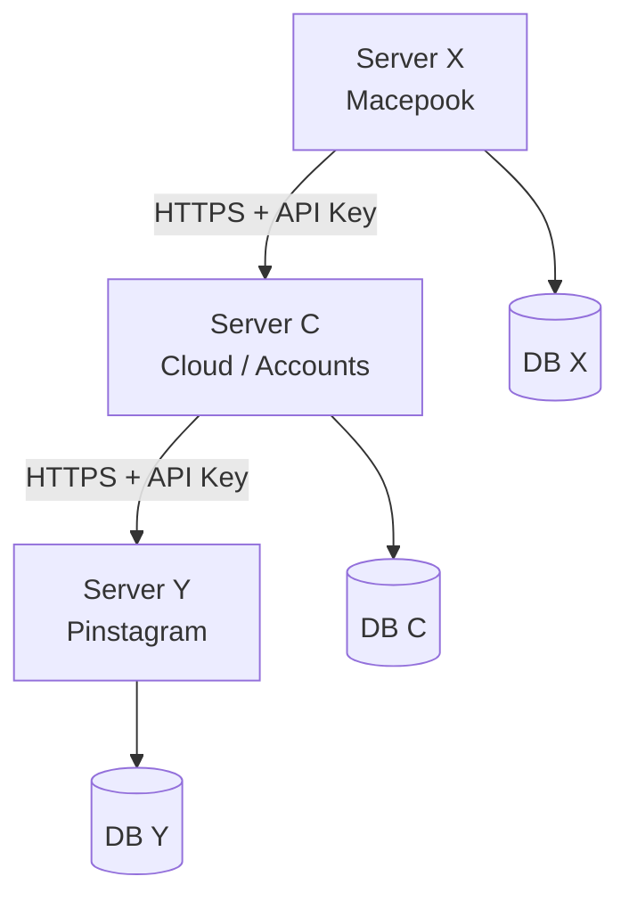
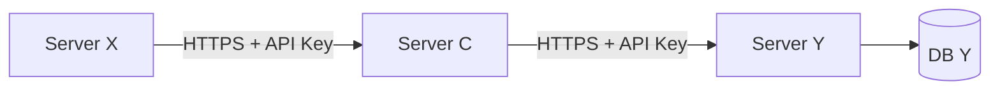
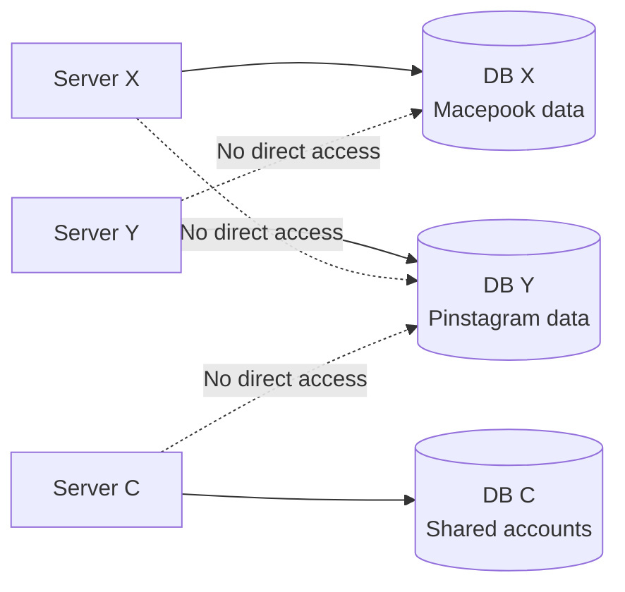
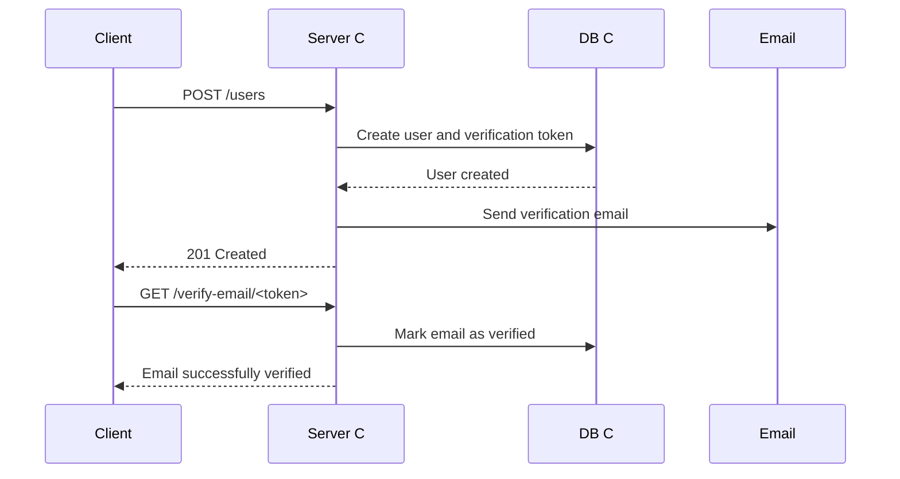
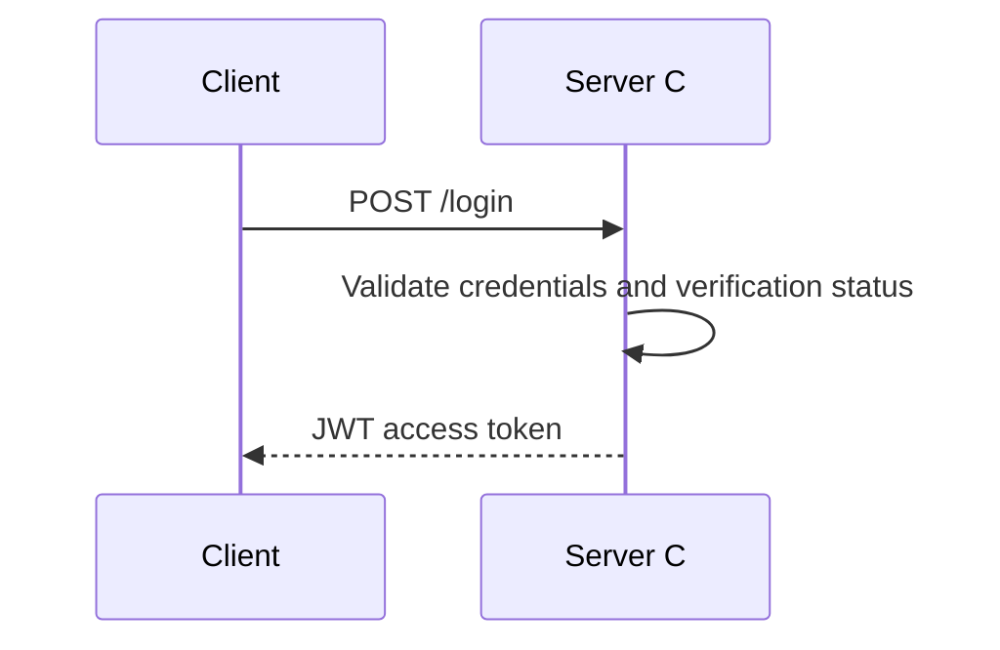
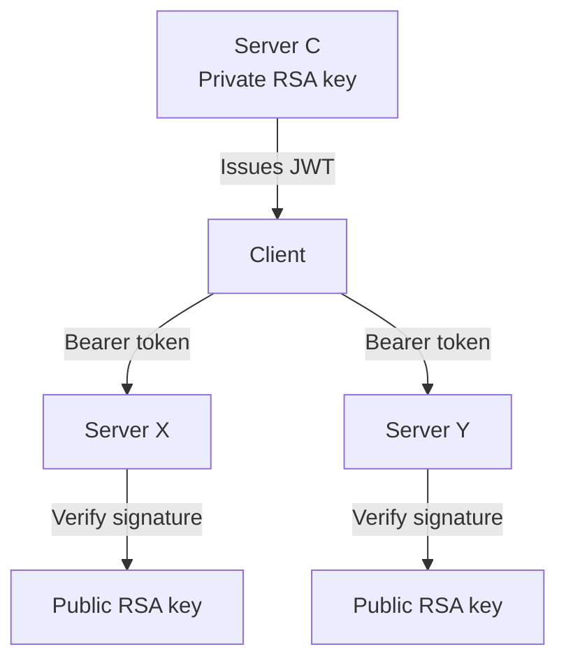
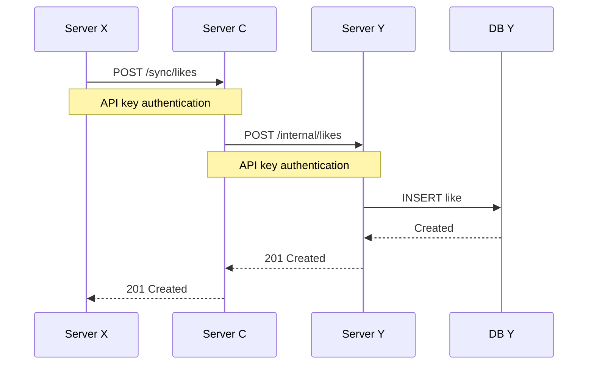

# Backend / Cloud Solution with Python

A distributed backend system built with **Python, Flask, PostgreSQL, Neon and Vercel**.

The project demonstrates how three independent backend services can communicate securely while maintaining separate databases and clear ownership of their data.

> **The main architectural rule:**
> Services communicate through APIs, not through each other's databases.
> Nobody gets direct access to somebody else's database. If Server X needs something from Server Y, it has to go through the front door.

---

# 1. Project Overview

The system consists of three independent Flask services:

- **Server X — Macepook:** social interactions for the first platform.
- **Server Y — Pinstagram:** social interactions for the second platform.
- **Server C — Cloud:** shared user accounts, authentication and cross-service coordination.

Each service has its own PostgreSQL database hosted on Neon.

Server C is responsible for shared user accounts and authentication. It also acts as an intermediary when one social service needs to trigger an operation on another.

## Architecture



The synchronization path is:



Server X never connects directly to DB Y.

Server C also does not connect directly to DB Y. It asks Server Y to perform the operation through its API.

This keeps database ownership clear and allows the services to remain independent.

---

# 2. Services

## Server X — Macepook

**Responsibility:** handles likes, comments and reactions for Macepook.

**Database:** DB X

**Production URL:**
https://server-x-five.vercel.app

### Endpoints

| Method | Endpoint | Purpose |
|---|---|---|
| GET | `/` | Health/status check |
| POST | `/likes` | Create a like |
| GET | `/likes/<user_id>` | Get user's likes |
| POST | `/comments` | Create a comment |
| GET | `/comments/<user_id>` | Get user's comments |
| POST | `/reactions` | Create a reaction |
| GET | `/reactions/<user_id>` | Get user's reactions |
| POST | `/sync/likes` | Request synchronization through Server C |

Social endpoints require a valid JWT access token issued by Server C.

The `/sync/likes` endpoint uses an API key to authenticate the request to Server C.

Server X does not manage user registration or login. Shared accounts are managed by Server C.

---

## Server Y — Pinstagram

**Responsibility:** handles likes, comments and reactions for Pinstagram.

**Database:** DB Y

**Production URL:**
https://server-y.vercel.app

### Endpoints

| Method | Endpoint | Purpose |
|---|---|---|
| GET | `/` | Health/status check |
| POST | `/likes` | Create a like |
| GET | `/likes/<user_id>` | Get user's likes |
| POST | `/comments` | Create a comment |
| GET | `/comments/<user_id>` | Get user's comments |
| POST | `/reactions` | Create a reaction |
| GET | `/reactions/<user_id>` | Get user's reactions |
| POST | `/internal/likes` | Internal endpoint used by Server C |

Social endpoints require a valid JWT access token issued by Server C.

The `/internal/likes` endpoint is protected by an API key and is intended for service-to-service communication. It is not a public client endpoint.

Server Y does not manage user registration or login.

---

## Server C — Cloud

**Responsibility:** manages shared user accounts, authentication, email verification and cross-service communication.

**Database:** DB C

**Production URL:**
https://server-c-iota.vercel.app

### Endpoints

| Method | Endpoint | Purpose |
|---|---|---|
| GET | `/` | Health/status check |
| POST | `/users` | Register a shared user |
| GET | `/users/<user_id>` | Retrieve the authenticated user's profile |
| POST | `/login` | Authenticate a user and issue a JWT |
| GET | `/verify-email/<token>` | Verify an email address |
| POST | `/resend-verification` | Resend an email verification link |
| POST | `/sync/likes` | Forward a like operation to Server Y |

Server C owns DB C and stores shared user account information.

Registration and login are performed directly through Server C. Both social services accept JWT access tokens issued by Server C.

---

# 3. Database Ownership

One of the main requirements of the assignment is independent database ownership.



| Service | Database | Owns |
|---|---|---|
| Server X | DB X | Macepook likes, comments and reactions |
| Server Y | DB Y | Pinstagram likes, comments and reactions |
| Server C | DB C | Shared users and email verification tokens |

The services do not share database credentials.

There are no cross-database foreign keys. Each service is responsible for its own data and schema.

---

# 4. Shared User Accounts and Authentication

Both social platforms use the same user account stored in DB C.

The client registers directly with Server C:



After email verification, the user can log in:



The same access token can be used with Server X and Server Y.

## Password Security

Server C uses Werkzeug password hashing to store password hashes.

## Email Verification

Email verification uses securely generated, single-use tokens:

- Tokens are generated using Python's `secrets` module.
- Only SHA-256 token hashes are stored in the database.
- Tokens expire after 24 hours.
- Used tokens cannot be reused.
- Users can request a new verification email.

---

# 5. JWT Authentication

The system uses JSON Web Tokens for authentication between clients and the social services.

**Algorithm:** RS256
**Access token lifetime:** 30 minutes

Server C signs access tokens using its RSA private key.

Server X and Server Y verify tokens using the corresponding public key.



The social services do not issue their own user tokens.

User identity is derived from the validated JWT rather than trusted from an arbitrary client-supplied identity.

---

# 6. Data Synchronization

Suppose a user creates a like on Macepook that also needs to be reflected on Pinstagram.

Server X does not access DB Y.

Instead:



The synchronization flow is:

1. Server X receives a synchronization request.
2. Server X authenticates with Server C using an API key.
3. Server C authenticates with Server Y using a separate API key.
4. Server Y validates the request and writes the like to DB Y.
5. Server Y returns the result to Server C.
6. Server C forwards the response to Server X.

The database operation is performed only by its owning service.

Duplicate likes are prevented by a database uniqueness constraint on `(user_id, post_id)`.

---

# 7. Security

The project uses a service-to-service security model appropriate for the assignment.

## HTTPS

The deployed services communicate using HTTPS through Vercel.

## JWT

- RS256 asymmetric signing.
- Private key kept by Server C.
- Public key used by Server X and Server Y.
- Access tokens expire after 30 minutes.
- Protected endpoints require a valid token.

## API Keys

Internal service-to-service endpoints require API keys.

The keys are stored in environment variables and are not hard-coded into the source code.

## Database Credentials

Database connection strings are stored in environment variables and are not committed to Git.

## Passwords and Verification Tokens

- Passwords are stored as Werkzeug password hashes.
- Email verification tokens are stored as SHA-256 hashes.
- Verification tokens expire and cannot be reused.

---

# 8. Database Migrations

Database schema changes are managed using Flask-Migrate and Alembic.

Each service has its own migration directory:

- `server_c/migrations`
- `server_x/migrations`
- `server_y/migrations`

Migrations are managed independently for each database.

## Check migration status

Run the following commands from the repository root:

```powershell
flask --app server_c.app db current -d server_c/migrations
flask --app server_x.app db current -d server_x/migrations
flask --app server_y.app db current -d server_y/migrations
```

To check whether model definitions differ from the database schema:

```powershell
flask --app server_c.app db check -d server_c/migrations
flask --app server_x.app db check -d server_x/migrations
flask --app server_y.app db check -d server_y/migrations
```

## Apply migrations

```powershell
flask --app server_c.app db upgrade -d server_c/migrations
flask --app server_x.app db upgrade -d server_x/migrations
flask --app server_y.app db upgrade -d server_y/migrations
```

When running Flask CLI commands for Server X or Server Y from the repository root, disable automatic root `.env` loading so that each service uses its own environment file:

```powershell
$env:FLASK_SKIP_DOTENV = "1"
```

After completing the migration commands:

```powershell
Remove-Item Env:FLASK_SKIP_DOTENV
```

Migrations are applied explicitly. They are not executed automatically during application startup.

---

# 9. Deployment

The three Flask services are independently deployed on Vercel.

## Production Services

| Service | Vercel URL |
|---|---|
| Server C | https://server-c-iota.vercel.app |
| Server X | https://server-x-five.vercel.app |
| Server Y | https://server-y.vercel.app |

Each service has its own Vercel project and production environment variables.

Each service also has its own Neon PostgreSQL database.

The services can therefore be deployed and maintained independently.

## Vercel Configuration

The repository uses a shared Vercel entry point:

```text
api/index.py
```

The deployment selects the target service using the `SERVICE_NAME` environment variable:

```text
SERVICE_NAME=C
SERVICE_NAME=X
SERVICE_NAME=Y
```

This allows the same repository structure and deployment entry point to serve three independent Vercel projects.

Each service has its own `requirements.txt`.

---

# 10. Local Development

## Prerequisites

- Python 3.12
- Git
- PostgreSQL database access through Neon
- Vercel CLI (for deployment)

## Create and activate the virtual environment

```powershell
python -m venv .venv
.venv\Scripts\Activate.ps1
```

If PowerShell activation is restricted, use Command Prompt:

```cmd
.venv\Scripts\activate.bat
```

## Install dependencies

```powershell
pip install -r requirements.txt
```

Each service also contains its own `requirements.txt` for deployment.

## Environment Files

Configure the environment files separately:

```text
.env
server_x/.env
server_y/.env
```

The root `.env` contains Server C's local configuration.

Server X and Server Y load their own service-specific environment files.

Never commit these files to Git.

## Run the Services

Each service can be started independently.

### Server C

```powershell
python server_c/app.py
```

Default local address:

```text
http://127.0.0.1:5000
```

### Server Y

```powershell
python server_y/app.py
```

Default local address:

```text
http://127.0.0.1:5001
```

### Server X

```powershell
python server_x/app.py
```

Default local address:

```text
http://127.0.0.1:5002
```

---

# 11. Limitations

This project demonstrates core backend and cloud architecture concepts. It is an educational solution and is not intended to be a production-scale distributed platform.
